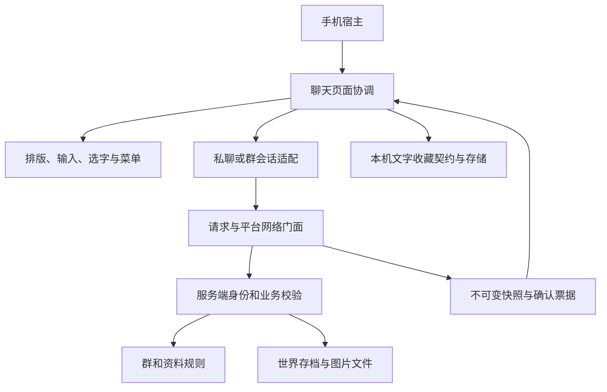

# 美西螈 APP 累计开发工程审查报告

审查日期：2026-10-13。仓库：november521/mcphone。基线：`62c41b94dc36e54db6909becd8470ed67c32c489`（1.11.1 主分支），工作分支：`codex/chat-home-menu`。本报告同时覆盖此前尚未提交的联系人、群聊、邀请确认、个人介绍、文字收藏及图标改动，并明确区分本轮审查修正。

## 1. 结论与验收边界

**整体工程结构仍然适合继续开发，但不能评价为“没有问题”。** 页面、消息绘制、输入、群业务、存档与传输已有明确分工；共享代码没有为了增加功能而混入加载器 API。私聊与群聊通过会话适配器共用组件，收藏使用独立文字快照，群邀请没有以客户端显示状态代替服务器成员资格。

本轮发现并修正了八类实际问题或维护隐患：新版群存档缺失历史边界时套用旧默认值、群图片失败写入被重复上传误认、收藏字段缺失被默认值接受、协议状态依赖枚举顺序、断线清理分散、请求策略重复、资料票据耗尽越过异常保护、关闭个人子页与旧绘制入口的状态/依赖残留。没有重写整个 APP，也没有把每个像素值都变成配置项。

仍需维护的主要区域是历史 `ChatService`、手机总导航 `PhoneScreen`、图片写入与回收的完整并发流程，以及多设备的当前会话缓存边界。这些在第 9 节说明，不能用测试数量或文件数量掩盖。

本报告是代码与自动化审查记录。没有启动、结束或安装游戏，也没有修改玩家存档；未取得新一轮游戏实测截图，不宣称视觉验收完成。Linux CI 的最终运行身份与结果在交付报告的验收补记及 PR Checks 中记录。

## 2. 审查方法与范围

先核对仓库规则、工作区状态、分支、最近提交和远端，读取实际实现再修改。受保护的另一个 `mcphone` 目录只读取规则，所有开发在 `mcphone-local-updates` 中完成。

扫描范围包括共享聊天 Java 文件及其导入、版本和加载器包包装、四个平台注册/退出回调、聊天关联的手机导航、语言与素材声明、测试和工程检查规则。人工重点阅读生命周期、服务端鉴权、邀请批次、历史合并、个人删除、图片异步任务、个人介绍和收藏持久化链路。没有声称逐行形式化证明全部源码，也没有运行性能基准或第三方整合包兼容测试。

核查原则：

- 业务规则是否由服务器裁定，客户端是否只呈现快照和交出意图。
- 页面和组件是否各自拥有状态，绘制与点击是否共用几何。
- 请求是否有目标、票据、失效规则与明确清理时机。
- 存档和网络是否有容量、字段、版本和类型约束。
- 常量是稳定契约、设计参数，还是容易漂移的重复规则。
- 新增类型是否遵守 shared/layers/platforms 边界，所有目标是否通过真实构建和检查。

## 3. 规模指标：用于定位维护热点

统计口径为 `shared/src/main/java/com/november/mcphone/feature/chat` 下 Java 源文件；行数含注释、空行，不含构建生成源码。数字不是质量评分，也不是完整依赖度量。

| 指标 | 审查前 | 修正后 |
| --- | ---: | ---: |
| 共享聊天 Java 文件 | 105 | 109 |
| 源文件总行数 | 9,267 | 9,422 |
| 客户端文件 | 59 | 61 |
| 群模块文件 | 22 | 24 |
| 服务端个人资料文件 | 4 | 4 |
| 原私聊/好友与 net 文件 | 20 | 20 |
| 上述非 client 目录显式导入 `net.minecraft.client.*` 的文件 | 0 | 0 |

新增四个类型各有明确职责：`FavoriteCodec`、`GroupImageFileIO`、`GroupClientPolicy`、`ChatClientLifecycle`。这项增加是为隔离文件契约、二进制 IO、请求策略和平台退出挂载，不是按每一个按钮机械拆文件。

主要阅读热点：

| 文件 | 修正后行数 | 判断 |
| --- | ---: | --- |
| `ChatImageSender` | 494 | 同时包含压缩梯度、动画、排队和上传确认；有充分注释，但后续图片扩展应优先拆压缩策略 |
| `ChatList` | 386 | 搜索、摘要合并、行绘制和导航协调仍较集中，当前容量有界 |
| `ChatService` | 371 | 好友、名字、消息和图片引用协调集中，属于现存服务端技术债 |
| `ChatImageCache` | 335 | 字节预算、贴图生命周期和请求调度分工尚可，仍须验证异步竞态 |
| `ChatMessagePane` | 303 | 只消费传入快照；旧直接读私聊缓存入口已移除 |
| `ChatConversation` | 254 | 保持会话生命周期、适配器、输入与动作协调；没有退回早期 952 行实现 |
| `PhoneScreen`（整个手机，非聊天专属） | 1,824 | 聊天仍依赖宿主的模式分发；增长压力存在，需要下一阶段专门导航重构 |

## 4. 当前文件架构与依赖关系

以下 Java 路径均以 `shared/src/main/java/com/november/mcphone/` 为前缀，未注明的客户端组件为内部实现，不是附属模组的稳定 API。

```text
core/client/PhoneScreen                 手机宿主导航与输入分发
feature/chat/
├─ ChatService / FriendGuard            原私聊与好友业务、权限
├─ ChatData / FriendData / ...          世界存档与纯规则
├─ net/ChatClientCache                 不可变私聊数据快照，无游戏客户端类型
├─ client/
│  ├─ ChatList / ChatContacts           消息与联系人页面协调
│  ├─ ChatContactDirectory/Pane/Row/...  A–Z、搜索、滚动、共用选人视图
│  ├─ ChatGroupCreate/Details/Notices    建群、详情与邀请确认
│  ├─ ChatGroupInvite/Rename/MemberGrid  选人、改名草稿、成员网格
│  ├─ ChatConversationChannel           群与私聊的数据/命令适配
│  ├─ ChatConversation                  会话生命周期和组件协调
│  ├─ ChatMessageLayout/Pane/ScrollState 消息排版、绘制与滚动
│  ├─ ChatComposer / ChatAttachment     输入和附件语义
│  ├─ ChatTextLayout / ChatTextSelection 字素命中和单消息拖选
│  ├─ contextmenu/ / messageaction/     菜单绘制与复制/收藏/删除操作
│  ├─ ChatImageSender/Cache/Viewer/...   压缩、缓存、按需请求、查看与上传归属
│  ├─ ChatProfile/Details/FavoritePane  我页、服务端确认草稿、本机收藏视图
│  ├─ favorite/FavoriteText             独立完整正文快照
│  ├─ favorite/FavoriteCodec            JSON 字段和类型契约（新增）
│  ├─ favorite/FavoriteStore            文件定位之外的读写、容量与失败保护
│  ├─ favorite/ChatFavorites            当前玩家/服务器/世界文件定位
│  ├─ profile/ProfileClientCache        有界且可取消的资料票据
│  └─ ChatClientLifecycle               四个平台统一退出清理（新增）
├─ group/
│  ├─ GroupBook / GroupInvitations       纯群规则、成员和邀请索引
│  ├─ GroupRoom/Member/Message/...       不可变状态与 DTO
│  ├─ GroupData / GroupService           保存、世界与玩家身份协调
│  ├─ GroupImageAssembly                按连接、群、票据与片序拼接
│  ├─ GroupImageFiles                   文件引用、锁和后台回收
│  ├─ GroupImageFileIO                  完整文件写入与修复（新增）
│  └─ net/                             有界契约、服务端协调、纯客户端快照
│     └─ GroupClientPolicy              轮询、等待与容量策略（新增）
└─ profile/                            介绍规则、存档与协议/服务器门面

layers/version/1.20.5+/...              现代 payload / StreamCodec 包装
layers/loader/neoforge/...              两个 NeoForge 版本共用注册
platforms/1.20.1-forge/...              老 Forge 包包装与注册
platforms/1.21.1-fabric/...             Fabric 注册与载荷支持检查
platforms/<target>/MCphoneClient        只挂载统一生命周期与监听器
api/chat/                              原有附属接口；未添加群/资料/收藏内部类型
```

核心依赖可以概括为：



这是数据流和职责图，不表示每条箭头都是 Java import。`GroupImageAssembly` 是业务与传输的集成组件，接受上传 DTO；不能据“位于 group 目录”就称整个目录完全没有网络依赖。纯规则边界主要由 `GroupBook`、`GroupInvitations`、`ProfileBook` 承担。

## 5. 本轮问题、修正与证据

| 编号 | 等级 | 原问题 | 修正与验证 |
| --- | --- | --- | --- |
| A1 | 高 | 格式 2/3 的 `joined_after` 仍使用可缺省 codec；字段缺失会放宽入群历史可见性 | 当前 codec 要求字段，格式 1 单独用 legacy codec；`GroupInviteTest` 覆盖格式 1 正常迁移、格式 2/3 缺失及错误类型锁定、原 NBT 保留 |
| A2 | 中 | 群图片直接写最终文件，去重只看文件存在；失败留下的半份文件会阻止相同内容重试修复 | `GroupImageFileIO` 同目录临时文件写完再替换，内容匹配才去重；实际磁盘故障注入覆盖失败前后及同长度损坏 |
| A3 | 中 | Gson 记录反序列化可把缺失 boolean/long 填成 false/0，改变收藏来源语义或接受不完整数据 | 独立 `FavoriteCodec` 要求全部字段、正确类型、规范 UUID 与精确整数；缺字段、类型错、溢出、未来格式拒读并保留原文 |
| A4 | 中 | 群状态 `ordinal()`、资料 `writeEnum()` 依赖枚举声明顺序，往返测试不能发现未来重排造成的语义错位 | 显式固定 ID，保持群 0–11、资料 0–4；固定字节编码/解码测试与未知 ID 拒绝测试 |
| A5 | 中 | 四个平台各自重复登记聊天断线清理，群传输文字票据主要依赖下次绑定连接才清空 | `ChatClientLifecycle.disconnect()` 集中清理任务、群传输、快照、资料、本机运行时绑定和贴图；四个平台只调用它 |
| A6 | 低 | 群操作的 15s、3s、16 个待处理请求散落在页面、传输与缓存；群图片 20 个 ID 重复于模型和编码器 | `GroupClientPolicy` 与 `GroupLimits.IMAGE_REQUEST_IDS` 集中维护；资料等待和票据上限由 `ProfileClientCache` 常量统一 |
| A7 | 中 | 资料 `begin()` 在 try 之外，收件箱耗尽时异常直接越过页面保护 | 分配票据和发包放在同一异常边界，失败不留下假等待；生产页面测试覆盖耗尽和发送失败 |
| A8 | 低 | 个人页 close 没有归一化内部页面/返回状态；消息绘制器仍有直接读取私聊缓存的旧重载 | 关闭归一化，删除未被调用的旧重载；绘制只使用会话适配层传入的快照；导航与排版回归检查 |

此外修正文档漂移：联系人文档不再把已实现的个人页写作预留；群协议说明更新为当前 Forge 11 / NeoForge 8；旧审查报告明确链接本次累计审查。

A1 是损坏/不完整存档恢复路径中的权限风险，并不是已经证实正常多人游戏发生越权。A2 是 IO 失败路径中的完整性风险，并不是本轮发现玩家图片已经损坏。对应测试以构造异常输入或注入写入故障复现路径，不能夸大成线上事故。

## 6. 硬编码的具体判断

| 类型 | 例子 | 处理方式 |
| --- | --- | --- |
| 固定协议契约 | payload v3/v1、命令种类 ID、状态 ID、编码容量 | 保留明确编号和容量，补稳定字节检查；禁止借助枚举顺序隐式编号 |
| 服务端业务容量 | 群 128 人、每人 32 群、每世界 4096 群、邀请有效期 7 天 | 现有 `GroupLimits` 集中维护，不让客户端自行扩大，不在本轮增加用户配置或迁移 |
| 客户端等待策略 | 群轮询 3s、操作等待 15s、资料等待 6s | 同一语义只保留一处规则；没有把所有恰好相同的数字强行合并 |
| 设计参数 | 搜索栏 12、正文字号 .75、群昵称 .50、头像尺寸、卡片边距 | 保留 `ChatLayout`/专用 layout 的设计值；绘制与点击共用几何，未改外观 |
| 图标校准 | 96px 原稿的可见轮廓尺寸和中心 | 保留每张素材的测量值，属于资源元数据；不能用同一裸缩放使不同透明边距的图标看起来不齐 |
| 产品身份 | 本项目 GitHub 地址、保存路径、语言键、格式号 | 固定产品身份合理，不为此引入额外配置服务；源码扫描未发现本机用户名路径或 JDK 路径进入聊天业务 |
| 表现阈值 | 99+ 未读显示、头像拼合最多四格 | 明确 UI 规则，区别于消息/成员容量，不应混为一条业务上限 |

没有将图片保留数 20 与群图片请求协议容量 20 合并：当前数值相同，但用途不同。没有将资料 6s、删除 6s 与下载重试 6s 合并：将来应能独立调整。这比建立一个包揽全部数字的“常量总表”更容易维护。

## 7. 权限、状态和保存审查

**群资格与邀请。** 服务端使用连接玩家身份，修改操作检查当前有效玩家和手机。建群及邀请先完整校验好友、群人数和配额再写入；收到邀请不等于成为成员。只有被邀请者本人可同意/拒绝，处理同时匹配邀请 ID 和群 ID。同意时再次校验，历史边界取当时服务器序号；退出/解散失去读取权限。复制和收藏不扩大服务器历史权限。

**删除与收藏。** 删除只隐藏本人的群或私聊记录，不删除他人的消息；标记随旧消息淘汰。收藏保存完整正文独立快照，源记录删除或离群不自动删除收藏。本机 JSON 按玩家和服务器/世界隔离，写成功才替换内存；有界读取和严格解码失败锁定，不以空列表覆盖坏文件。

**个人资料。** 公开介绍保存在当前 Minecraft 服务端主世界，不是跨服云账号；只有本人能改，读取是公开操作。草稿与展示分离，以成功确认更新；取消等待不能撤销已经在服务器执行的保存。资料和群存档遇到未知/损坏格式保留原 NBT。

**请求与页面。** 群历史、成员资料、删除和操作结果依靠目标、票据与版本约束。群和私聊使用独立缓存与导航意图；资料页关闭取消票据。收件箱、文字确认、会话消息和收藏均有容量上限。首页搜索只查本地摘要，不向服务器发送关键词。

**异步图片。** 客户端压缩使用原连接和独立上传票据；退出/换服取消旧任务。服务端后台写完会再次检查手机、身份和群成员资格；下载回到服务器线程后再次鉴权。客户端解码安装用 generation 拒绝旧结果；文件回收有锁、活动上传计数和修改时间保护。完整并发事务风险仍见第 9 节。

## 8. 自动化验证与发布兼容性

本轮针对性测试均已实际运行成功：

| 测试 | 当前断言 | 本轮增量 | 主要意义 |
| --- | ---: | ---: | --- |
| `ChatWireCompatibilityTest` | 40 | 40 | 固定字节意义、双向解码与非法状态 |
| `GroupImageFileIOTest` | 9 | 9 | 真实文件写入失败、完整旧文件保护、残缺修复及去重 |
| `ChatClientLifecycleTest` | 9 | 9 | 实际统一断线入口、旧上传和旧票据拒收 |
| `FavoriteStoreTest` | 594 | 59 | 字段/类型/整数/UTF-8/文件大小与坏文件保留 |
| `ChatProfileInteractionTest` | 28 | 3 | 资料票据耗尽、发送失败与关闭页面 |
| `GroupInviteTest` | 52 | 6 | 新旧格式的历史边界与原文保护 |
| `GroupPacketCodecTest` | 43 | 0 | 四平台真实包包装的全部请求/响应往返及边界 |
| `GroupClientCacheTest` | 40 | 0 | 历史与推送交错、删除、目标隔离、离群与断线 |
| `ChatMessageLayoutTest` | 15 | 0 | 排版边界回归 |

本轮新增 **126 条断言**；它们覆盖错误路径和真实契约，未删除、跳过或弱化既有测试。累计扫描到 46 个聊天测试文件，口径是 `docs/*Test.java` 中引用 `feature.chat` 的文件，并非测试覆盖率指标。

完整平台验证使用各平台自己的 wrapper，先聚焦测试，再运行 `build --continue --no-daemon --max-workers=1 --no-parallel`：

| 平台 | Java | 本机完整构建的判断 |
| --- | --- | --- |
| Forge 1.20.1 | 17 | 编译/打包及 16 个 verify 任务通过；110 个断言测试任务中仅 Economy 失败；使用已有离线缓存 |
| NeoForge 1.21.1 | 21 | 编译/打包及 22 个 verify 任务通过；111 个断言测试任务中仅 Economy 失败 |
| Fabric 1.21.1 | 21 | 编译/打包及 22 个 verify 任务通过；111 个断言测试任务中仅 Economy 失败 |
| NeoForge 26.1.2 | 25 | 编译/打包及 22 个 verify 任务通过；116 个断言测试任务中仅 Economy 失败 |

本机 Windows 的既有 `EconomyDataTest` 使用 `Files.setPosixFilePermissions`，会抛 `UnsupportedOperationException`。保留该测试并记录失败，不能把它解释成聊天通过就等于完整构建全绿。PR Linux CI 继续运行完整构建，最终结论以实际 Checks 为准。

verify 数量按日志中的任务条目统计，包含校验任务自身的测试，不把它当作独立架构规则数量。Forge 一轮在证书检查处中断，同一安全配置重试后完成；没有关闭证书校验。

运行 `updateSeamsDoc`、`updateTwinBaseline` 后检查差异；目标中立、第三方导入白名单、客户端隔离、孪生、数据包目录、接缝、Mixin 包规则、私有 Rhino 身份/最终包及其他仓库闸门纳入完整验证。孪生基线仅由任务生成，不手改；其总数是整个仓库的行多重集差异，不是本轮聊天重复代码量。

本轮曾移除仍被旧绘制重载引用的导入，完整检查发现编译错误；确认没有调用方后删掉该旧入口，再重新执行最终聚焦和四平台检查。这个中间失败不算最终验收结果，也没有靠跳过编译掩盖。

当前协议仍为 Forge 11、NeoForge 8，Fabric 检查 group v3 与 profile v1 支持；客户端与服务器须同时更新这批累计功能。此次审查保持已有状态字节、正常收藏格式 1、群格式 3 和个人资料格式 1，不改 `mod_version=1.11.1`，不执行发版或合并。

## 9. 尚未消除的技术债与限制

| 优先级 | 区域 | 事实/风险与建议 |
| --- | --- | --- |
| 中 | `ChatService` | 好友、名字解析、消息和图片引用协调集中，且返回 net 摘要 DTO。未来按好友业务/消息业务及查询投影逐步拆，保持原存档和公共 API 行为；本轮没有证明它已完全低耦合 |
| 中 | `PhoneScreen` | 总手机导航 1,824 行，多个聊天模式分别接入渲染、键盘、返回与续开。下一次大幅扩页前抽聊天导航协调器；需要 GUI/HUD/附件/续开完整回归，不能只机械挪 switch |
| 中 | 图片文件与消息存档 | 临时文件替换解决写入完整性，不能使图片和 SavedData 成为一个事务。回收快照、重复发送、退出、服务器停机交错仍缺完整调度测试；修改时间还依赖墙钟，未验证钟回拨情形 |
| 中 | 多设备会话 | 目前每个客户端主要只有一份当前私聊/群消息快照，不能据两部手机的页面实例互相独立就宣称同时缓存多会话。已覆盖 HUD 恢复，但长期多设备并行需要单独设计与验收 |
| 中 | 超时重试语义 | 取消客户端等待不撤销服务端已执行命令；建群重新提交新票据可能得到另一个群。当前限流/禁止重复点击减少重复，不等同于服务端跨票据幂等。网络断开后重试去重需后续独立协议方案 |
| 低 | 实测和字体 | 默认字体的可见字形居中是校准，不等于任意资源包字体都精准；自动化没有打开 GL 游戏窗口验证最新图标/布局 |
| 低 | 同步收藏文件 IO | 上限 512 条、2MiB，读写在客户端操作线程，尚未测最慢磁盘延迟。若实测卡顿，应另做串行异步提交和状态确认，保留“成功才改快照” |
| 低 | 可读性 | 部分新增资料视图仍使用较密集的单行写法。后续修改相应组件时展开关键状态分支；没有为清理格式制造整个模块的无关大差异 |
| 低 | 产品限制 | 新朋友仍依赖在线摘要；头像只记住本次客户端已加载皮肤；备注属于当前服务器；群公告、管理员、@、语音、免打扰等未实现；赞助仅入口 |

这些是明确的剩余边界，并非本轮发现全都必然导致线上错误。用户提供的功能范围没有被擅自扩大。

## 10. 后续扩展约定

1. 新页面通过意图交给宿主，不直接控制其他页面；状态由组件实例持有。
2. 修改群资格或资料的操作走服务端规则和确认，不能把“点按钮成功”当成落库成功。
3. 新协议状态使用固定 ID；增加字段先决定兼容/迁移，别让 optional 默认值放宽权限。
4. 新缓存必须接入统一退出入口，说明容量、目标、线程、票据与失效条件。
5. 持久化格式与 IO 分开；损坏数据锁定保留，成功提交之后再改展示快照。
6. 布局值留在专用 layout；绘制和点击共用同一几何，资源校准附原稿与测量说明。
7. 附属继续使用稳定 `api/chat`，不要把 Rhino、客户端组件、群内部状态塞进公开协议/存档/API。
8. 新目标只在 layers/platforms 接 API 差异，新增/移动类型生成接缝并跑完整 CI。

## 11. 最小游戏验收清单

使用客户端和服务端一致的包，至少三个玩家检查：建群邀请同意前不可见历史、同意后文字/图片、群主改名和普通成员邀请、个人删除与收藏快照、两个玩家查看公开备注、保存重进及换服隔离、GUI/HUD 和附件返回。截图检查消息/联系人搜索、标题图标、群昵称与头像、个人页四个图标；不同缩放、中文/英文/多行、资源包字体各留代表样本。

图片磁盘写失败和损坏文件由自动化故障注入检查，不要求玩家破坏实际存档来复现。自动化结果与游戏验收分别记录。

## 12. 交付追溯

审查前源码快照、规模扫描结果、聚焦/完整构建日志保存在本地 `chat-engineering-audit-work`；它们不作为开发依赖写入仓库。本报告随 PR 保存，最终交付副本附 PR、已验证提交、Linux CI 运行与四平台本机失败/成功分类。PR 覆盖本地尚未提交的累计功能和本轮工程修正，未直接推送主分支。
